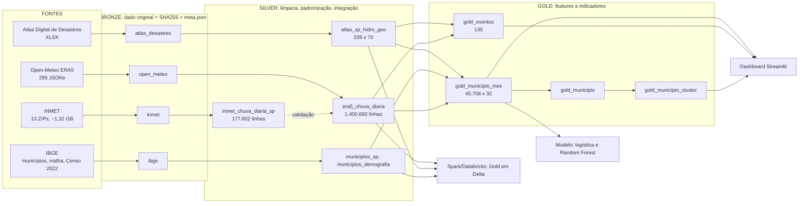

# Arquitetura da solução

Pipeline Medallion (Bronze, Silver, Gold) para chuvas extremas e desastres no estado de SP, 2013-2025. Escopo processado: 293 dos 645 municípios (ver limitações).

## Diagrama

## Camadas

| Camada | Conteúdo | Regras principais |
|---|---|---|
| Bronze | Arquivos como baixados | Sem alteração; SHA256 em `docs/manifesto_bronze.csv`; `.meta.json` com URL, data UTC, bytes |
| Silver | Parquet limpo e padronizado | Filtro de tipologias do Atlas; INMET com -9999 nulo, UTC para America/Sao_Paulo, `dia_confiavel` (>= 20 h); C891 excluída; chaves por código IBGE |
| Gold | Painel município-mês e indicadores | Features de chuva, eventos do Atlas pelo mês de Data_Evento, população, clusters, índice de prioridade |

## Fluxo e ordem de execução

Scripts em `src/`, executados da raiz do repositório: 01 a 05 (Atlas, INMET, IBGE, pontos), 06 (download Open-Meteo, idempotente), 07 (ERA5 Silver), 08 (escopo), 09 (demografia), 10 (Gold), 11 (validação ERA5 x INMET), 12 (indicadores e clusters), 13 (modelo), 14 (robustez), `dashboard.py`.

## Qualidade, rastreabilidade, atualização, confiabilidade

- **Qualidade:** validações descritas no catálogo (duplicados 0, datas nulas 0, chaves IBGE conferidas, 645 municípios e 645 feições).
- **Rastreabilidade:** hash SHA256 de cada arquivo da Bronze e metadados de download.
- **Atualização:** scripts idempotentes. Para ampliar o escopo, baixar os municípios faltantes e reexecutar 07, 08, 10, 12 e 13.
- **Confiabilidade:** ERA5 validado contra 23 estações do INMET (r diário mediano 0,52; r mensal 0,82).
- **Reprodutibilidade entre motores:** o Gold foi recalculado em Spark e bateu com o pandas: 45.708 linhas, 120 positivos, 135 eventos.

## Decisões técnicas

- Chuva por município via ERA5, pois só 41 de 645 municípios (6,4%) têm estação INMET.
- Modelagem em município-mês: em município-dia seriam cerca de 3,06 milhões de linhas com ~0,011% de positivos.
- Parquet em vez de CSV (tipos preservados, compactação).
- Dados fora do GitHub (`.gitignore`); só código e documentação são versionados.

## Limitações

- Escopo de 293 municípios por limite de cota da API; amostra não aleatória.
- 214 células ERA5 distintas para 293 municípios.
- Camadas em disco local; apenas o Gold foi publicado em tabela Delta no Databricks (`workspace.default.gold_municipio_mes`).
